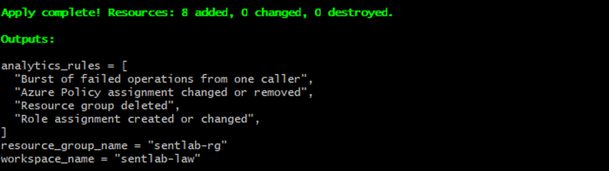
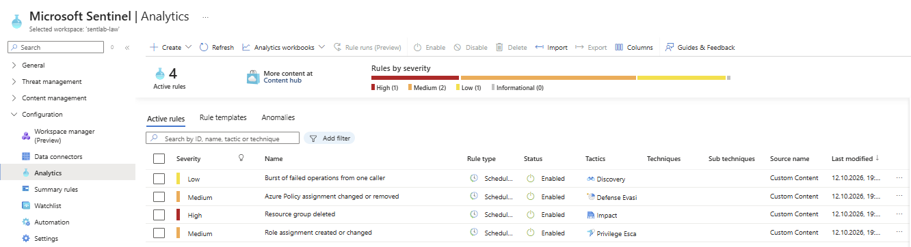
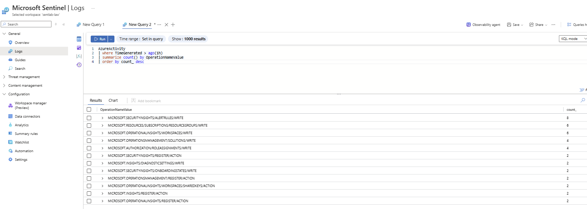
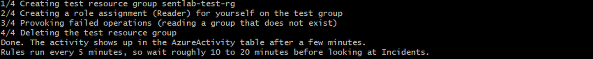
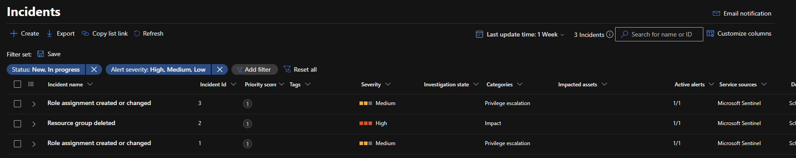
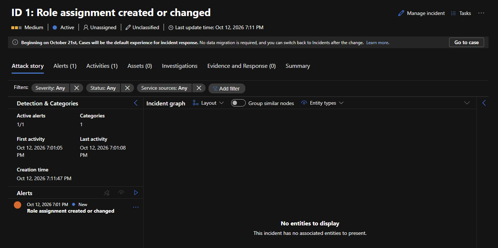

# Azure Sentinel Detection Lab

[](https://github.com/adankhalid0/azure-sentinel-detection-lab/actions/workflows/ci.yml)

A small lab that turns on Microsoft Sentinel in an Azure subscription, sends the Activity Log to it, and adds four detection rules written in KQL. A script then creates harmless test activity so the rules fire and the alerts can be inspected as incidents.

It builds on my [azure-security-baseline](https://github.com/adankhalid0/azure-security-baseline), which sets up logging and policy. This project is the next step: not only collecting logs, but detecting something in them.

This is a learning lab on a personal subscription. It is not a production setup.

## What it sets up

| Area | Resources | Why |
| --- | --- | --- |
| Logging | Log Analytics workspace with a daily ingestion cap | Central place for logs, with a cost limit |
| SIEM | Microsoft Sentinel onboarded on the workspace | Detection rules and incidents on top of the logs |
| Data | Subscription Activity Log (Administrative, Security, Policy, Alert) | Shows who did what in Azure |
| Detection | Four scheduled analytics rules in `queries/` | See below |

## Detections

| Rule | Severity | MITRE tactic | What it looks for |
| --- | --- | --- | --- |
| Role assignment created or changed | Medium | Privilege escalation | A role was given to someone |
| Resource group deleted | High | Impact | A whole resource group was removed |
| Azure Policy assignment changed or removed | Medium | Defense evasion | A guardrail was changed or switched off |
| Burst of failed operations from one caller | Low | Discovery | Five or more failed operations in ten minutes |

The rules are plain KQL files, so they can be pasted into the Logs view and tested before they are deployed.

## Requirements

- Terraform 1.6 or newer
- Azure CLI, logged in (`az login`)
- A subscription where you can create resources and role assignments (Owner is simplest)
- These resource providers registered once (the Terraform provider is set not to register them itself):

```bash
az provider register --namespace Microsoft.OperationalInsights
az provider register --namespace Microsoft.OperationsManagement
az provider register --namespace Microsoft.SecurityInsights
az provider register --namespace Microsoft.Insights
```

## Deploy

```bash
cp terraform.tfvars.example terraform.tfvars   # put your subscription id in the file
terraform init
terraform plan
terraform apply
```

## Trigger test activity

```bash
bash scripts/trigger-events.sh
```

The script creates a test resource group called `sentlab-test-rg`, gives you the Reader role on it, tries to read a few resource groups that do not exist, and deletes the test group again. Reading is not logged in the Activity Log, so the read step does not trigger any rule (see "What I learned"). It only touches that group. On Windows, run it from Git Bash (the script turns off Git Bash's path conversion, which otherwise breaks the `--scope` argument).

Wait 10 to 20 minutes. The Activity Log reaches the workspace after a few minutes, and the rules run every five minutes. Then look at the incidents. Microsoft has moved the Incidents page from the Azure portal to the Defender portal (`security.microsoft.com`, under Investigation & response). You can also check that the data arrived in **Logs** in Sentinel:

```kusto
AzureActivity
| where TimeGenerated > ago(1h)
| summarize count() by OperationNameValue
| order by count_ desc
```

## Results

I deployed the lab on a personal Azure subscription, ran the test script and destroyed everything again. The screenshots are from that run.

**Deploy.** `terraform apply` created 8 resources: the resource group, the workspace, the Sentinel onboarding, the Activity Log export and four analytics rules.



**Rules.** The four rules are active in Sentinel, with severity and MITRE tactic.



**Data.** The Activity Log reaches the workspace. The query shows the operations from the deployment and the test, including `ROLEASSIGNMENTS/WRITE`.



**Test activity.** The script creates a test resource group, assigns a role, and deletes the group.



**Incidents.** About ten minutes later the rules had created three incidents: two for "Role assignment created or changed" (Medium) and one for "Resource group deleted" (High).





**Clean-up.** `terraform destroy` removed all 8 resources.


Two of the four rules did not fire in this run. Nobody changed an Azure Policy assignment, and the "failed operations" rule needs failed write operations (see below).

## What I learned

- **Reads are not in the Activity Log.** My first idea for provoking the "failed operations" rule was to read resource groups that do not exist. Only changes are logged, so that never gives the rule anything to find. A better test needs failed writes, for example a deployment that is rejected.
- **Git Bash rewrites paths.** The role assignment step failed with `MissingSubscription`, because Git Bash turned the scope `/subscriptions/...` into a Windows path. Setting `MSYS_NO_PATHCONV=1` in the script fixed it.
- **The incident block needs grouping.** Without an explicit `incident` block, Terraform leaves it to Azure whether alerts become incidents. In the `azurerm` 4.x provider the block also requires a `grouping` block, so every rule sets `create_incident_enabled = true` and `grouping { enabled = false }`.
- **Detection takes time.** The role assignment happened at 19:01 and the incident was created at 19:11. Logs take a few minutes to arrive, and the rules run every five minutes.
- **Incidents moved.** The Incidents page in the Azure portal now redirects to the Defender portal.
- **Incidents show no account.** The incidents have no entities, because the rules do not map `Caller` and `CallerIpAddress` to an account and an IP address. The detail view therefore does not show who did it.

## Cost and clean-up

- The workspace has a daily ingestion cap (`log_daily_quota_gb`, default 1 GB). When the cap is reached, ingestion stops until the next day, so no new data is detected after that. Check the current Sentinel pricing and free trial in the Azure portal before you deploy.
- Remove everything when you are done:

```bash
terraform destroy
```

## Limitations

- Only the Azure Activity Log is used. Sign-in logs from Microsoft Entra ID are not included, because exporting them needs a paid Entra ID plan.
- The rules are simple examples with fixed thresholds. They have not been tuned on real traffic, and the role assignment rule also fires when you assign roles yourself.
- The policy rule and the failed-operations rule were not triggered in my test run.
- The incidents contain no entities (account and IP address), so they do not show who made the change.
- No automated response (playbooks) and no workbooks yet.
- Terraform state is local. Do not commit it.

## Possible next steps

- Add entity mappings (`Caller` as account, `CallerIpAddress` as IP) to the rules, so incidents show who did it.
- Test the policy rule and the failed-operations rule with failed write operations.
- Add a playbook (Logic App) that sends a notification when a high-severity incident appears.
- Add Entra ID sign-in logs and rules for failed sign-ins if a suitable licence is available.
- Add a Sentinel workbook that shows incidents over time.
